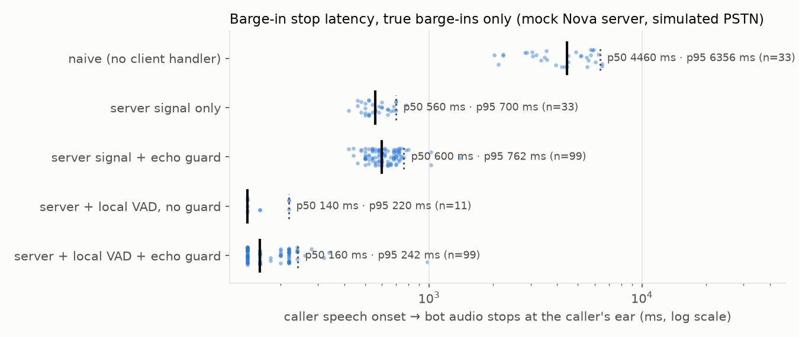
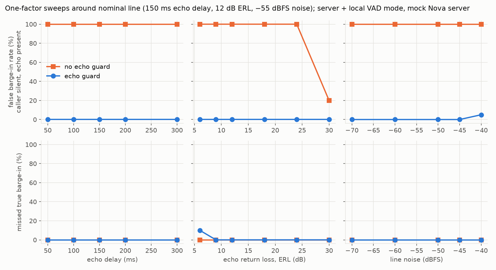
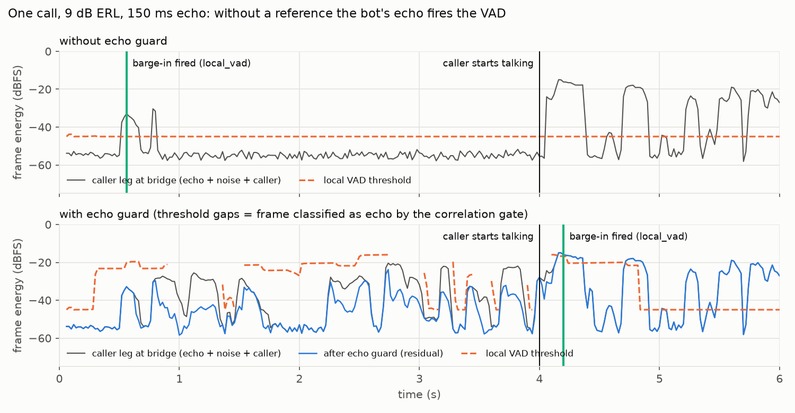

# Nova Sonic telephony barge-in

**A telephony bridge for Amazon Nova 2 Sonic: Twilio Media Streams (8 kHz μ-law) in, Nova's bidirectional stream out. It adds client-side barge-in and an echo guard, and comes with a reproducible phone-line testbed that measures both.**

> **Status.** All numbers below come from a **mock Nova Sonic server** and a **simulated phone line**. They are not measurements of the real Nova 2 Sonic service. The real Bedrock client is written and imports cleanly, but it has not been run yet (no AWS session was available). Real-Nova numbers are **pending**: see [docs/RUN_WITH_REAL_NOVA.md](docs/RUN_WITH_REAL_NOVA.md).

## The problem

Nova 2 Sonic detects barge-in on the server. When it does, it stops generating and signals the interruption. Because it generates faster than real time, the [barge-in guide](https://docs.aws.amazon.com/nova/latest/nova2-userguide/sonic-barge-in.html) leaves four steps to the client: detect the signal, stop playback, clear the queued audio, and resume with new audio. The signal is documented as `contentEnd.stopReason == "INTERRUPTED"` ([output events](https://docs.aws.amazon.com/nova/latest/nova2-userguide/sonic-output-events.html)). Audio is 16-bit LPCM at 8/16/24 kHz each way ([input events](https://docs.aws.amazon.com/nova/latest/nova2-userguide/sonic-input-events.html)).

The docs say nothing about phone calls. On a phone call:

1. **Audio is buffered where the client can't see it.** A bridge that forwards Nova's audio as it arrives fills Twilio's playback buffer seconds ahead. Stopping it takes a Twilio `clear`, and the bridge must also drop chunks of the interrupted response that are still in flight.
2. **The bot hears itself.** The 8 kHz μ-law caller leg carries the bot's own voice back as line or handset echo. With no echo reference, both Nova's server-side turn detection and any local VAD can take that echo for the caller and interrupt the bot mid-sentence.

The bridge does know exactly what it played. This repo uses that as the echo reference.

## What's here

| Piece | File | Notes |
|---|---|---|
| G.711 μ-law codec | `novabridge/g711.py` | vectorised numpy, bit-exact with the classic Sun reference (CPython `audioop`) |
| Streaming resampler | `novabridge/resample.py` | polyphase Kaiser-sinc, state carried across 20 ms frames; 8k→16k up, 24k→8k down |
| Nova event builders / parser | `novabridge/nova_events.py` | documented Nova 2 Sonic JSON shapes, shared by the real client and the mock |
| **Real Nova 2 Sonic client** | `novabridge/nova_client.py` | official `aws_sdk_bedrock_runtime` (`InvokeModelWithBidirectionalStream`), Python ≥ 3.12, **not yet run** |
| **Barge-in handler** | `novabridge/bargein.py`, `novabridge/bridge.py` | stop sending, flush queue, Twilio `clear`, tombstone the interrupted `contentId` to drop late chunks; triggered by server signal **or** local VAD |
| **Echo guard** | `novabridge/echo_guard.py` | reference cross-correlation delay lock, 32 ms NLMS, Geigel double-talk, playback-aware VAD threshold, reference-correlation gate, upstream echo gate; pure numpy |
| Twilio websocket server | `novabridge/server.py` | asyncio; `--backend mock` or `--backend nova` |
| Mock Nova server | `testbed/mock_nova.py` | streams faster than real time, naive server energy VAD (so echo can cause *server* false barge-ins), configurable decision latency |
| Simulated phone line | `testbed/phone_line.py`, `testbed/sim.py` | Twilio buffer + `clear`, echo delay / ERL / coloration / noise, μ-law, ground-truth onsets |
| Benchmarks | `bench/run.py`, `bench/e2e.py` | virtual-clock sweeps + a real-time run over real websockets |
| Tests | `tests/` | codec, resampling, Nova events, barge-in flush logic, echo guard, mock server, sim |

## Results (mock Nova server, simulated PSTN)

How these numbers were produced is in [docs/TESTBED.md](docs/TESTBED.md). In short:

- **Stop latency** is measured from the moment the caller starts talking (ground truth) to the end of the last bot frame the caller hears.
- **False barge-in** means the bot was interrupted while the caller was silent: either the mock server's VAD fired, or the local VAD flushed playback.
- Every configuration ran on the same 200 randomised calls.

<!-- RESULTS:START -->
_Generated by `python -m bench.run` from `results/summary.json`. Mock Nova Sonic server + simulated PSTN line; **not** real Nova 2 Sonic numbers. n = 100 barge-in calls + 100 caller-silent calls per row (same calls for every row; random echo delay 50–300 ms, ERL 6–30 dB, noise −65…−45 dBFS, server decision latency 150–450 ms)._

| Client configuration | Stop latency p50 | Stop latency p95 | False barge-in (caller silent) | False barge-in before caller spoke | Missed true barge-in |
|---|---:|---:|---:|---:|---:|
| naive (no client handler) | 4,460 ms | 6,356 ms | 68% | 67% | 0% |
| server signal only | 560 ms | 700 ms | 68% | 67% | 0% |
| server signal + echo guard | 600 ms | 762 ms | 1% | 0% | 1% |
| server + local VAD, no guard | 140 ms | 220 ms | 92% | 89% | 0% |
| server + local VAD + echo guard | 160 ms | 242 ms | 1% | 0% | 1% |

Inbound-path CPU per 20 ms frame with the echo guard (decode + guard + VAD + resample): p50 0.22 ms, p99 0.70 ms, max 0.93 ms over 6,890 frames (budget 20 ms; macOS-27.2-arm64-arm-64bit / Python 3.11.11). Median bulk-delay estimate error: 2.6 ms.

<details><summary>Sweep table (n = 20 per point per call type)</summary>

| Sweep | Value | False barge-in, no guard | False barge-in, guard | Missed, no guard | Missed, guard |
|---|---:|---:|---:|---:|---:|
| echo_delay_ms | 50 | 100% | 0% | 0% | 0% |
| echo_delay_ms | 100 | 100% | 0% | 0% | 0% |
| echo_delay_ms | 150 | 100% | 0% | 0% | 0% |
| echo_delay_ms | 200 | 100% | 0% | 0% | 0% |
| echo_delay_ms | 300 | 100% | 0% | 0% | 0% |
| erl_db | 6 | 100% | 0% | 0% | 10% |
| erl_db | 9 | 100% | 0% | 0% | 0% |
| erl_db | 12 | 100% | 0% | 0% | 0% |
| erl_db | 18 | 100% | 0% | 0% | 0% |
| erl_db | 24 | 100% | 0% | 0% | 0% |
| erl_db | 30 | 20% | 0% | 0% | 0% |
| noise_dbfs | -70 | 100% | 0% | 0% | 0% |
| noise_dbfs | -60 | 100% | 0% | 0% | 0% |
| noise_dbfs | -50 | 100% | 0% | 0% | 0% |
| noise_dbfs | -45 | 100% | 0% | 0% | 0% |
| noise_dbfs | -40 | 100% | 5% | 0% | 0% |

</details>
<!-- RESULTS:END -->







**What the committed run shows.** The paragraphs below quote `results/summary.json`; if you rerun, the table above regenerates and these sentences may drift.

- **The client-side handler is what makes barge-in feel immediate.** If the bridge ignores the interruption signal, the caller hears the rest of the buffered response: 4.5 s median. Flushing on Nova's signal gets that down to 560 ms median. Most of that is the *assumed* server decision latency (150–450 ms) plus network, so the real-Nova figure is pending. Adding a local VAD on the bridge gets it to 140–160 ms median.
- **On a phone line, a local VAD is unusable without an echo reference.** Without the guard, local-VAD mode stopped the bot on 92% of calls where the caller never spoke. With the guard it was 1%, with 1% missed true barge-ins and a p50 cost of 20 ms (160 vs 140 ms).
- **The guard also protects the server.** The mock server's naive VAD barged in on its own echo in 68% of caller-silent calls when it received raw caller audio. With echo-gated audio upstream it was 1%. How much of this carries over to real Nova, whose turn detection is a model rather than an energy threshold, is the main open question for the real run.
- **Sweeps (local-VAD mode, 20 + 20 calls per point).** Without the guard, the false-barge-in rate was 100% at every echo delay, at every ERL up to 24 dB, and at every noise level; it fell to 20% only at 30 dB ERL. With the guard it was 0% everywhere except the loudest noise (−40 dBFS: 5%, where the mock server's VAD fires on line noise alone). The cost is at very low ERL: at 6 dB, where the echo is about as loud as the caller, the guard's conservative threshold missed 2 of 20 true barge-ins (10%). One was caught 2.1 s late; the other was never caught.
- **Real-time capable.** In a serial pass over 6,890 frames, the inbound path with the guard (decode, guard, VAD and 8k→16k resample) took p50 0.22 ms, p99 0.70 ms and max 0.93 ms per 20 ms frame, in pure numpy on Python 3.11. The bulk-delay estimate was within 2.6 ms of the true delay (median).

### Real-time run over websockets (localhost, mock backend)

This run uses the production asyncio server and a fake Twilio caller streaming 20 ms frames in real time. No network delay was added, and the line is benign (30 dB ERL), so the run isolates latency.

<!-- E2E:START -->
_Generated from `results/e2e_realtime.json` (`python -m bench.e2e`): Real-time localhost websocket run with the mock Nova backend (not real Nova). No network delay added. Benign line (echo delay 100 ms, ERL 30 dB, noise -60 dBFS) so that the run isolates stop latency; false barge-ins are studied in the simulator._

| Client configuration | Calls | Stop latency p50 | Stop latency max | Bot still talking 4 s after the caller started |
|---|---:|---:|---:|---:|
| naive (no client handler) | 5 | 3,311 ms (n=1) | 3,311 ms | 4 of 5 |
| server signal only | 5 | 585 ms (n=5) | 655 ms | 0 of 5 |
| server + local VAD + echo guard | 5 | 67 ms (n=5) | 75 ms | 0 of 5 |
<!-- E2E:END -->

### Pending: real Amazon Nova 2 Sonic

| Measurement | Status |
|---|---|
| Stop latency, server-signal path, against real Nova 2 Sonic | **pending**: needs an AWS session, see [RUN_WITH_REAL_NOVA.md](docs/RUN_WITH_REAL_NOVA.md) |
| Does real Nova barge in on its own echo on 8 kHz lines, and at what ERL? | **pending** |
| Echo-guard benefit against real Nova turn detection | **pending** |
| Real PSTN call (Twilio number), dual-channel recording | **pending** |

## Reproduce

Requires macOS (for `say`), `ffmpeg` and Python 3.11.

```bash
make venv          # python3.11 -m venv .venv && pip install -r requirements.txt
make test          # pytest
make bench         # python -m bench.run && python -m bench.e2e  (~4 min on a 10-core laptop)
```

`make bench` synthesises the speech into `.cache/` (nothing large is committed). It then writes `results/*.csv|json|png` and rewrites the two tables in this README. Use `python -m bench.run --quick` for a smoke run, or `python -m bench.run --dev` to rerun on the tuning seeds.

To try the bridge itself: `make serve-mock`, then point a Twilio `<Connect><Stream url="wss://…/media"/>` at it. Run `python -m novabridge.server --backend nova` (Python ≥ 3.12 venv, AWS credentials) to use real Nova.

## How the barge-in handler works

```
caller frame ─▶ μ-law decode ─▶ echo guard ─▶ local VAD ──┐
                    │ (reference: frames the bridge sent)   ├─▶ barge_in(): stop sending, flush queue,
Nova contentEnd INTERRUPTED ───────────────────────────────┘     Twilio "clear", tombstone contentId
Nova audioOutput ─▶ drop if contentId tombstoned ─▶ 24k→8k ─▶ μ-law ─▶ playout queue ─▶ paced 20 ms ticks
```

- **Paced playout with a 3-frame (60 ms) lead**, instead of forwarding everything. A lost or late `clear` can leave at most ~60 ms in Twilio's buffer. Because the bridge knows what is playing *now*, that audio can serve as the echo reference. Without pacing, the testbed measured a median peak of 5.2 s of audio buffered in Twilio when no interruption happened.
- **Tombstones.** After a local trigger, Nova keeps streaming the interrupted response until its own detector catches up. Those chunks, and any that arrive after the server signal, are dropped by `contentId`, so the bot doesn't resume mid-word. In the guarded local-VAD configuration, the main run dropped 922 such chunks.

## How the echo guard works

The bridge knows exactly what it played, so it uses that audio as the reference signal. Every step below is a few lines of numpy; see `novabridge/echo_guard.py`.

1. **Delay lock.** Normalised cross-correlation between the reference and the caller leg runs every 100 ms over a 600 ms range. It covers Twilio buffering, network delay and the echo path.
2. **NLMS canceller.** A 256-tap (32 ms) regularised NLMS filter runs on the delay-aligned reference. It adapts only when the caller isn't talking, according to a Geigel double-talk test scaled by the measured echo gain.
3. **Playback-aware VAD threshold.** The threshold is set to the echo expected on *this* frame:
   - an upper bound on echo-path gain measured from frames that have already echoed back;
   - after convergence, the canceller's measured residual;
   - the bound again on any frame where the canceller isn't actually removing echo, for example onsets after pauses.
4. **Reference-correlation gate.** A frame that correlates above 0.7 with the predicted echo is treated as echo.
5. **Upstream gate.** Frames judged echo-only are attenuated by 30 dB before being sent to Nova, so the server's turn detection doesn't hear the bot either.

## Caveats

- **Mock server.** The server-side figures (latency, false barge-ins) depend on the mock's assumptions: an energy VAD at −40 dBFS for 100 ms, and a 150–450 ms decision latency. Compare configurations against each other; don't read the absolute values as Nova numbers.
- **Linear echo only.** The simulated echo is linear and time-invariant. Real mobile legs (AMR transcoding, packet-loss concealment, handset noise suppression) will cancel worse.
- **Tuning overlap.** Guard parameters were tuned on development seeds, then frozen for the evaluation seeds. Both use the same 5 + 5 synthetic utterances, so treat the guard numbers as optimistic.
- **Latency resolution.** Latencies are quantised to 20 ms in the simulator.
- **Python versions.** The real Nova client needs `aws_sdk_bedrock_runtime`, which requires Python ≥ 3.12. The rest of the repo targets the 3.11 venv. The client was checked under 3.13: it imports, resolves its config and builds the client, without sending a request.
- **Amazon Connect.** Connect has no Twilio-style media stream. The core (`BridgeCore`) is transport-agnostic, and how it maps onto a Connect or SIP media path is sketched in the real-Nova doc.

## Upstream

[docs/UPSTREAM_PR.md](docs/UPSTREAM_PR.md) compares where this would fit:

- **Pipecat's `AWSNovaSonicLLMService`** already flushes and sends `clear` on `INTERRUPTED`, but has no echo-reference path.
- **The aws-samples Twilio integration** sends `clear` but forwards late chunks and has no pacing or echo handling.

The doc includes draft PR descriptions. Nothing has been submitted.

## Author and how this was built

Gabriel Velázquez Berrueta, software engineer (B.Eng., Universidad de Colima)
working on LLM and voice systems, with HCI research presented at MexIHC 2026.
[LinkedIn](https://www.linkedin.com/in/gabriel-velazquez-berrueta-53a3b925a/)

This project was built with Claude Code as a coding agent. I chose the problem,
set the ground rules (synthetic audio only, no number in this README that did not
come from a run, mock results labelled as mock, no paid AWS calls without a cost
estimate first) and reviewed the results; Claude Code wrote most of the
implementation and ran the testbed. Commits carry a `Co-Authored-By: Claude`
trailer.

## License

MIT © 2026 Gabriel Velázquez. Speech is synthesised locally with macOS `say`; no recordings are included.
